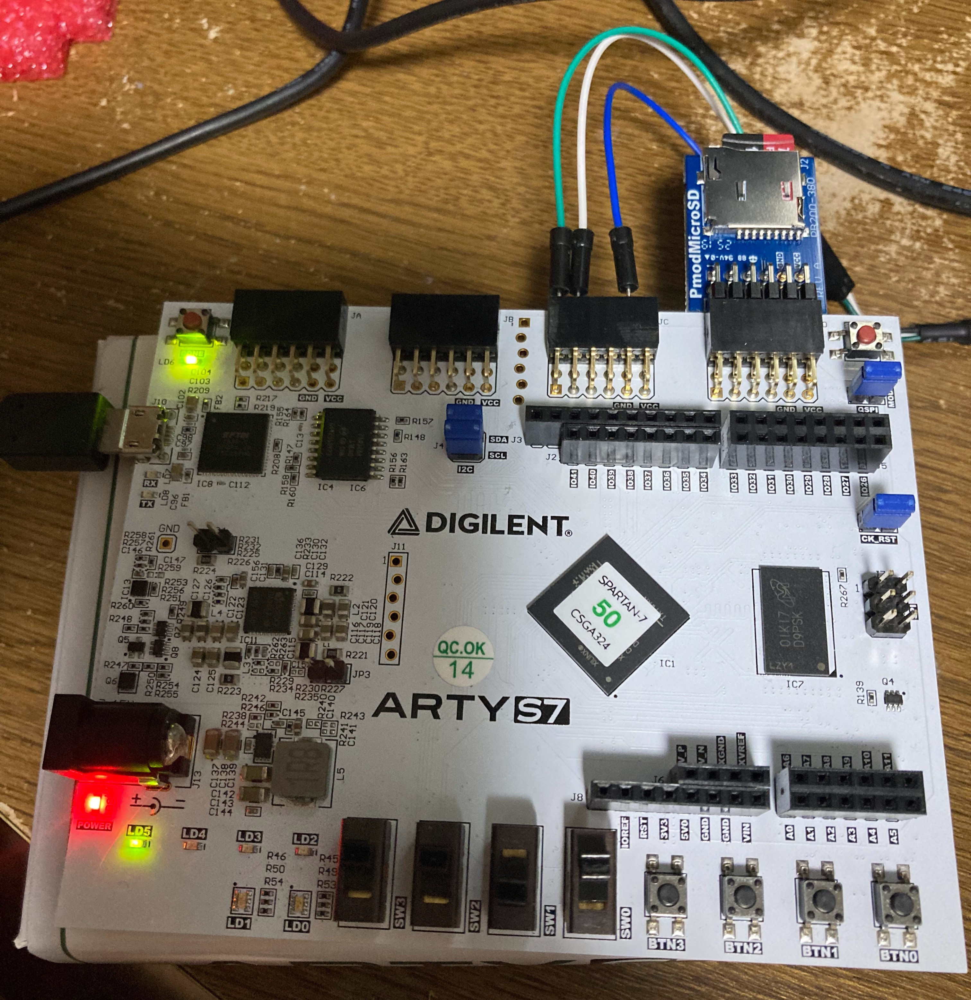
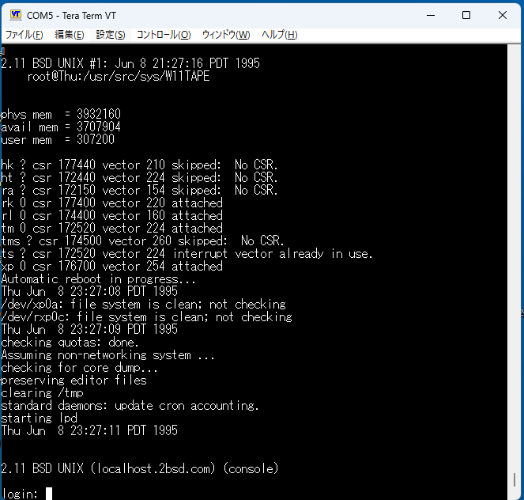

# w11: PDP-11/70 CPU と SoC — Arty S7 単体動作版

日本語 | [English](README.en.md)

このリポジトリは、W. F. J. Müller 氏の [w11](https://github.com/wfjm/w11) を
Digilent Arty S7-50 の上で PC なしに動かすためのフォークです。w11 の CPU と
DDR3 主記憶制御を土台に、次のものを加えています。

- microSD カードを直接読み書きする RP07、RK05、RL01/RL02 のディスク制御回路
- 基板のピンにつないだシリアル端末で使う DL11 コンソール
- FPGA の構成が終わると自動で OS を起動する起動回路

一本の回路データ（`.bit`）で三種類のディスクを扱います。カードの先頭ブロックの
ラベルでディスクの種類を選び、ラベルのないカードは RP07 として扱います。
2.11BSD と第6版 UNIX（V6）を、PC の I/O バックエンドなしで起動できます。

*右上の Pmod MicroSD に、2.11BSD のディスクイメージを書いた microSD カードが入っています。*

単体動作版で 2.11BSD を起動した端末の画面です。

## すぐに試す

[Release book-v1](https://github.com/itoh5588/w11/releases/tag/book-v1) に、
ビルド済みの回路データと microSD 用のイメージを置いています。どれも SHA-256 の
値を添えています。

| ファイル | 内容 |
| --- | --- |
| `sys_w11a_sa_as7.bit` | Arty S7-50 用の回路データ |
| `rp07_w11_tape481_fpsim.img.xz` | 2.11BSD（パッチ 481、FPSIM 入り）の RP07 イメージ |
| `v6_rk_card_labeled.img.xz` | 第6版 UNIX の RK05 イメージ（ラベル付き） |
| `CALDERA-LICENSE.txt` | V6 イメージに適用されるライセンス |

2.11BSD のイメージは、TUHS で公開されている配布テープから作ったものです。

## 書籍のコマンド集

[book-scripts](book-scripts/) には、書籍の本文にあるコマンドを節ごとに切り出した
PowerShell・sh・Tcl のスクリプトがあります。一覧と、それぞれを実行する場所は
[book-scripts/README.md](book-scripts/README.md) にあります。

## 資料

- [単体動作版のビルドと操作の手引き](rtl/sys_gen/w11a/artys7_standalone/README.md)（英語）：
  ハードウェアの構成、ビルド、ディスクの選び方、フロントパネル
- [SD_CARD.md](rtl/sys_gen/w11a/artys7_standalone/SD_CARD.md)（英語）：
  microSD イメージの作り方と配置
- [RP07 設計メモ](Docs/artys7_standalone_rp07_design.md)（日本語）：
  装置レジスタ、ディスクと SD の対応、試験の記録

## 公開元の w11 について

w11 は、DEC PDP-11 システムを丸ごと VHDL で記述したプロジェクトです。
メモリ管理装置付きの PDP-11/70 CPU、RK11/RK05・RL11/RL02・RH70/RP06・TM11/TU10
といった大容量記憶装置、DL11・LP11・PC11・DZ11・DEUNA などの UNIBUS 周辺装置、
キャッシュと SRAM・PSRAM・SDRAM の主記憶制御を含みます。Digilent の Arty A7、
Basys3、Cmod A7、Nexys A7 などの基板で動作し、第5版 UNIX、2.11BSD、DEC の各種 OS を
起動できます。

公開元の構成では、すべての装置の入出力を高速シリアルで PC 上のサーバーへ送り、
PC 側で現在の装置に対応付けています。このフォークは、その入出力を基板の上で
処理する単体動作版です。

公開元の詳しい資料は英語です。

- w11 プロジェクトの[ホームページ](https://wfjm.github.io/home/w11/)と
  [ブログ](https://wfjm.github.io/blogs/w11/)
- [変更履歴](doc/CHANGELOG.md)と[導入手順](doc/INSTALL.md)
- [Vivado でのビルド](doc/README_buildsystem_Vivado.md)、
  [テストベンチの実行](doc/w11a_tb_guide.md)、[OS の起動](doc/w11a_os_guide.md)
- 英語版の README は [README.en.md](README.en.md) です。

保守されている公開元は [wfjm/w11](https://github.com/wfjm/w11) だけです。
[freecores/w11](https://github.com/freecores/w11) は古い複製で、保守されていません。

## ディレクトリ

| ディレクトリ | 内容 |
| --- | --- |
| [book-scripts](book-scripts) | 書籍のコマンド集 |
| [doc](doc) | 公開元の資料 |
| [Docs](Docs) | 単体動作版の設計メモ |
| [rtl](rtl) | HDL のソース（主に VHDL） |
| [tools](tools) | 各種ツール |

## ライセンス

公開元と同じく [GPL V3](https://www.gnu.org/licenses/gpl-3.0.html) で公開しています。
各ファイルには [SPDX](https://spdx.org/) 形式の表示があります。

    SPDX-License-Identifier: GPL-3.0-or-later

ライセンスの全文はこのディレクトリの [License.txt](License.txt) にあります。
V6 のイメージは GPL ではなく、Release に添付した `CALDERA-LICENSE.txt` に従います。
